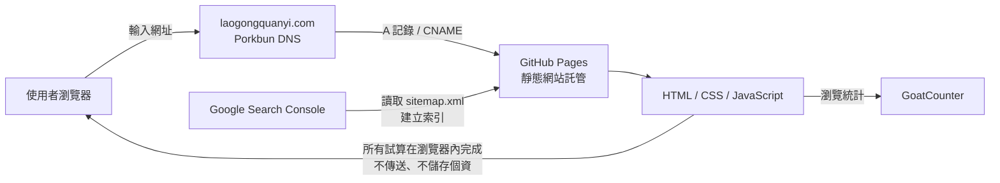
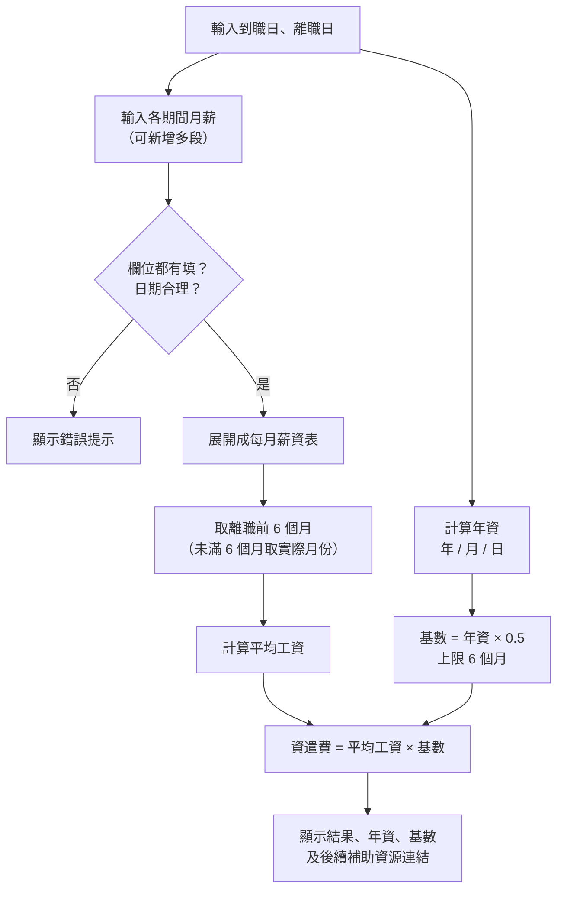

# 勞工權益計算機

🔗 **網站：[laogongquanyi.com](https://laogongquanyi.com)**

免費的勞動權益試算工具網站。依勞基法、勞工退休金條例、就業保險法、國軍退除役官兵輔導條例、公務人員請假規則等現行法規，讓使用者輸入幾個數字就能算出自己的權益。

## 功能

| 分類 | 工具 | 依據 |
|---|---|---|
| 一般勞工 | 薪資與加班費試算（可自訂加給、扣除項目） | 勞基法第 24、39 條 |
| | 特休天數試算 | 勞基法第 38 條 |
| | 資遣費試算（可分段輸入薪資，自動算離職前 6 個月平均工資） | 勞工退休金條例第 12 條 |
| | 離職預告期試算 | 勞基法第 16 條 |
| | 被資遣後可以申請什麼？（失業給付、職訓資源） | 就業保險法 |
| 軍警消、公務員 | 退伍軍人轉職資源（輔導類別、輔導期限、退輔會補助） | 國軍退除役官兵輔導條例 |
| | 榮民權益與補助（就醫、子女教育、急難救助、就養） | 退輔會公告 |
| | 警消轉職資源（退撫基金發還、年資保留） | 公務人員退休資遣撫卹法 |
| | 公務員休假天數試算（含初任按比例計算） | 公務人員請假規則第 7 條 |

## 系統架構



## 資料流程：以資遣費試算為例



## 技術與做法

- **前端**：純 HTML、CSS、JavaScript，不依賴框架，載入快、維護簡單
- **版面**：CSS Grid 左右分欄（選單 1/3、內容 2/3），手機版自動改為上方滑動選單；暖色調設計並支援深色模式
- **部署**：GitHub Pages + 自訂網域（Porkbun DNS，強制 HTTPS）
- **SEO**：每頁獨立網址、`<title>` / `description`、`sitemap.xml`、FAQPage 結構化資料（JSON-LD）
- **數據**：GoatCounter 統計瀏覽量（不使用追蹤 Cookie）
- **隱私**：所有計算在使用者瀏覽器端完成，不傳送也不儲存任何輸入資料

## 檔案結構

```
├── index.html          首頁
├── overtime.html       薪資與加班費試算
├── annual-leave.html   特休天數試算
├── severance.html      資遣費試算
├── notice-period.html  離職預告期試算
├── resources.html      資遣後補助與職訓資源
├── military.html       退伍軍人轉職資源
├── veteran-benefits.html 榮民權益與補助
├── police-fire.html    警消轉職資源
├── civil-leave.html    公務員休假天數試算
├── about.html          關於本站
├── privacy.html        隱私權政策
├── style.css           全站樣式
├── nav.js              選單互動
├── counter.js          瀏覽人次
├── sitemap.xml         網站地圖
└── CNAME               自訂網域設定
```

## 免責聲明

本站工具僅供參考，不構成法律意見。實際權益以主管機關規定及審核結果為準。
